

  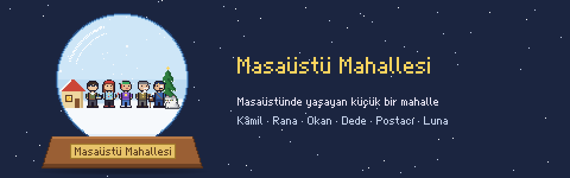

  <b>Masaüstünde yaşayan küçük bir mahalle: pencerelerinin üstünde yürüyen, çay içen, maç izleyen piksel komşular.</b>

  
  

  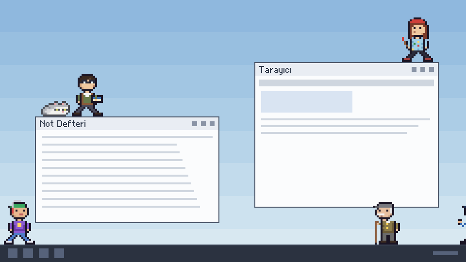

Masaüstü Mahallesi, bilgisayarını kullanırken arka planda sessizce yaşayan altı komşudan oluşur. Görev çubuğunun üst
kenarında ve açık pencerelerinin başlıklarında dolaşırlar, birbirlerine selam verirler, öğleden sonra çaya otururlar,
açtığın pencereye, izlediğin videoya ve oynadığın oyuna kendi tarzlarında tepki verirler. Sen işine devam edersin:
uygulama odak çalmaz, karakterlerin ve balonların dışındaki her tıklama alttaki pencereye geçer.

> "Tıklamanız alındı, sıra numaranız yedi." — Kâmil

---

## 🏘️ Mahalleli

Kurulumda kimlerin taşınacağını sen seçersin ve istersen her birine kendi adını verirsin (sonradan **Ayarlar →
Karakterler**'den de değişir). Aşağıdaki açıklamalar kurulum ekranındakilerle aynıdır.

<table>
  <tr>
    <td align="center" width="260">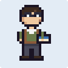 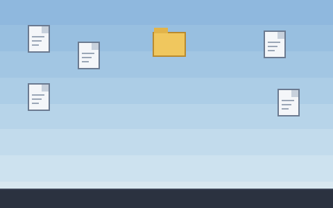</td>
    <td>
      <h3>Kâmil – Kütüphaneci</h3>
      Masaüstünün düzen bekçisi. Dağınık dosyalar için bir yerleşim planı hazırlar, sen onaylarsan yerleştirir ve her
      adım geri alınabilir. Titiz, kibar, biraz ukala.
      <ul>
        <li><i>"Tıklamanız alındı, sıra numaranız yedi."</i></li>
        <li><i>"Hiçbir şeyin adı 'yeni klasör' olmamalı."</i></li>
        <li><i>"Bir simge kayıp. Üstünde Luna uyuyor."</i></li>
      </ul>
    </td>
  </tr>
  <tr>
    <td align="center"> 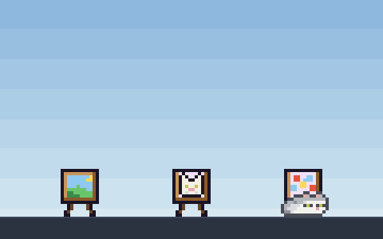</td>
    <td>
      <h3>Rana – Ressam</h3>
      Renklere ve açık pencerelere yorum yapar, ara sıra mahallede resim sergisi açar, fotoğraf çekilirken en öne geçer
      (Ayarlar'da "Ekran alıntısında: poz ver" seçiliyse).
      Neşeli ve hayalperest.
      <ul>
        <li><i>"Dur, kıpırdama! Seni çiziyorum."</i></li>
        <li><i>"Önlüğümdeki lekeler kaza değil. Sergi."</i></li>
        <li><i>"Rüyamda yeni bir mavi buldum..."</i></li>
      </ul>
    </td>
  </tr>
  <tr>
    <td align="center"> 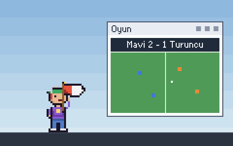</td>
    <td>
      <h3>Okan – Oyuncu</h3>
      Oyun ya da video açınca heyecanlanır, maçlarda tribüne çıkıp bayrak sallar. Esprili, gece kuşu, oyun jargonuyla
      konuşur.
      <ul>
        <li><i>"+10 XP! Bir tık daha, seviye atlarsın."</i></li>
        <li><i>"AFK değildim! Bekleme ekranındaydım!"</i></li>
        <li><i>"Kedilik bir oyun olsa, Luna şampiyon."</i></li>
      </ul>
    </td>
  </tr>
  <tr>
    <td align="center"> 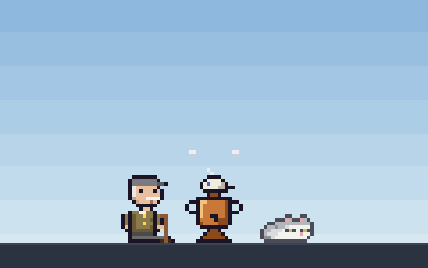</td>
    <td>
      <h3>Dede – Arşivci</h3>
      Mahallenin büyüğü. Çay saatini başlatır, eski dosyaları arşivler, eski günleri anlatır. Sakin ve tatlı dilli.
      <ul>
        <li><i>"Otur evlat, bir disket hikâyem var."</i></li>
        <li><i>"Semaver benden yaşlı, ama demi benden iyi."</i></li>
        <li><i>"Çaylar taze! Gelin evlatlar, demi kıvamında."</i></li>
      </ul>
    </td>
  </tr>
  <tr>
    <td align="center">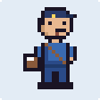 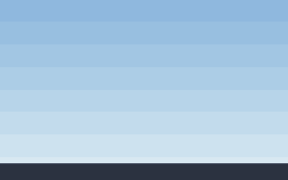</td>
    <td>
      <h3>Postacı</h3>
      Hatırlatmalarını, inen dosyaları ve günün gazetesini koşarak getirir; bildirim gelince köşeyi gösterir. Hep aceleci,
      hep güler yüzlü.
      <ul>
        <li><i>"Durursam paket soğur! Soğur mu? Soğumasın!"</i></li>
        <li><i>"On dakika imza bekledim! Kâmil işte."</i></li>
        <li><i>"Mesai başladı! Rota hazır!"</i></li>
      </ul>
    </td>
  </tr>
  <tr>
    <td align="center"> 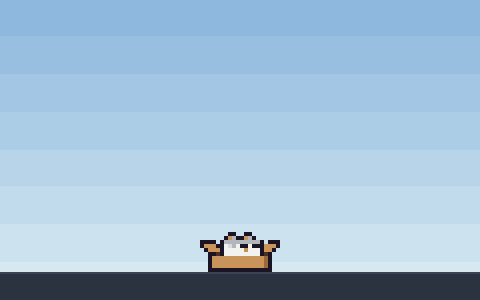</td>
    <td>
      <h3>Luna – Kedi</h3>
      Başına buyruk bir kedi. Pencerelerin üstüne yatar, imlece bakar, pati yoğurur, mama kabının başında bekler.
      Konuşmaz, sadece mırlar.
      <ul>
        <li><i>"mrrp?"</i></li>
        <li><i>"prr prr"</i></li>
        <li><i>"mrrrow!"</i></li>
      </ul>
    </td>
  </tr>
</table>

---

## ✨ Neler yapar?

### Pencerelere tepki verir

Açık pencereler mahallenin kaldırımlarıdır: karakterler başlıklarda yürür, birinden ötekine zıplar, pencere taşınınca
onunla birlikte gider, kapanınca düşer. Yeni bir pencere açınca yakındakiler başlarını çevirir, boştaki en yakın komşu
pencereye çıkıp köşesine oturur. Üstlerine bir pencere açılırsa savrulur, pencereyi sallarsan söylenirler.

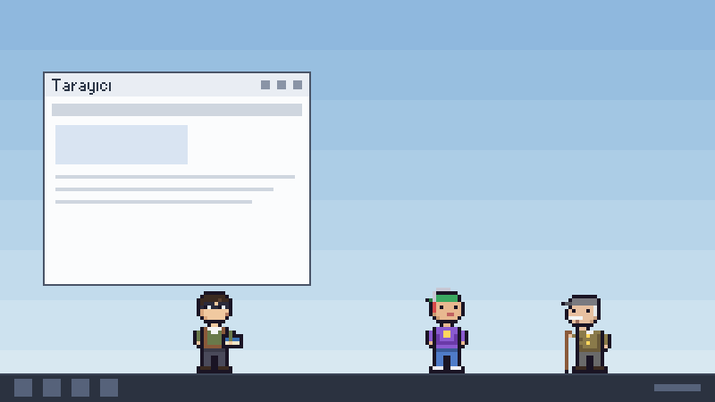

### Çay saati

Her gün (varsayılan 16:00) Dede semaveri kurar ve herkesi çaya çağırır; komşular iki yanına oturur, Luna yanına
kıvrılır, çaya özel sohbetler döner. Semavere tıklarsan biri senin için de bir çay ister. Tam ekran bir uygulama açıkken
ya da toplantıdayken çay sessizce atlanır.

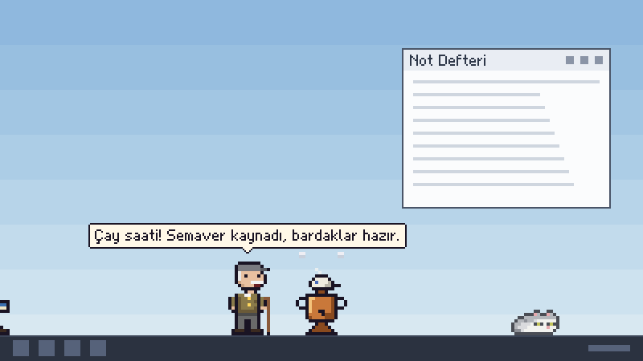

### Görev çubuğu gölü

Görev çubuğunda uygulama simgeleri ile saat arasındaki boşlukta küçük bir göl belirir (varsayılan olarak yan monitörde;
ayarlardan ana monitörde de açılır). Dede iskelede balık tutar, tutulan balık kovaya girer, Luna karşı kıyıda pusuya
yatıp kovadan balık aşırmayı bekler. Kışın göl donar, Dede buz deliğinde balık tutar. Göl tıklamaları engellemez; alan
daralınca küçülür, sığmazsa kurur.

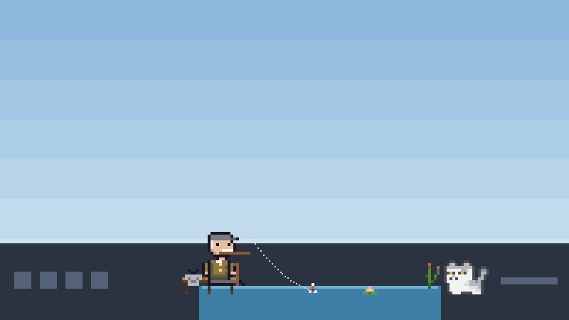

### Tribün, sinema ve müzik

Tanıdığı bir oyun başlayınca Okan elinde bayrakla oyunun yanında (oyun tam ekransa öteki monitörde) durur, bir iki
komşu tribüne oturur. Rekabetçi bir oyun kapanınca "Kazandık mı?" diye sorarlar; kazandıysan konfeti. Bir videoyu birkaç
dakika izlersen iki üç kişi izlemeye oturur, Okan'ın kucağında mısır olur. **Ses tepkileri** açıksa (Ayarlar → Mahalle
hayatı → Algı) müzik çalarken ritme göre kafa sallarlar.

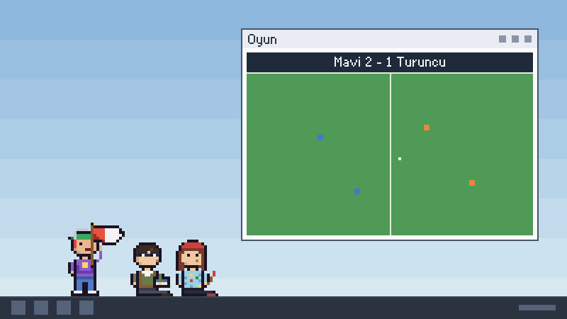

### Mevsimler

Mahalle takvime bakar: ilkbaharda tutamlar ve kelebek (Luna peşinden koşar), pencere başlığına konan serçe, sonbaharda
ekranın üstünden süzülen yapraklar (Postacı arada bir yığar), kışın kar birikintisi, buz sarkıtları ve yeterince kar
biriktiyse kardan adam. Hava gerçek değildir; mevsime göre ara sıra hayali kar ya da yağmur olur ve yalnızca birikme
olarak görünür.

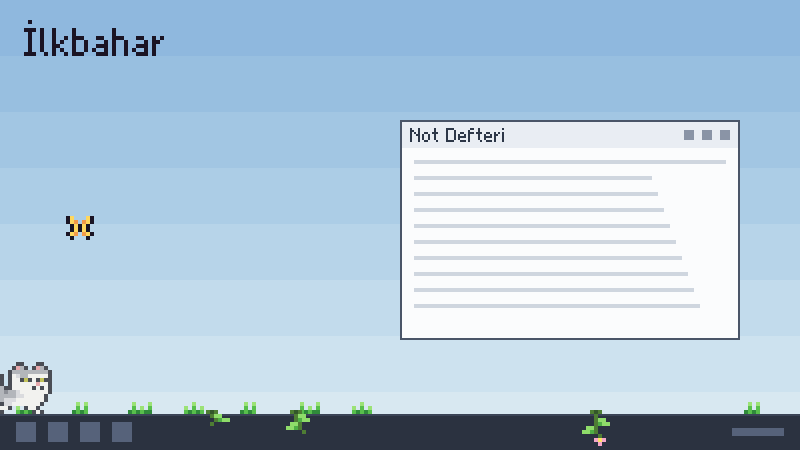

### Canlılık

Boştayken de canlıdırlar: göz kırpar, nefes alır, ağırlık değiştirirler. Biri yukarı bakınca yakındakiler de bakar.
Yanından geçen komşuya selam verilir (Okan ile Postacı çak yapar), karşılıklı yürüyenler "pardon" deyip yol verir.
Pazartesi sabahı biraz yavaş, cuma akşamı biraz hızlıdırlar. Canlılık **Sakin**, **Normal** ya da **Şenlikli** olarak
ayarlanır.

### Bildirimler ve hatırlatmalar

Postacı hatırlatmalarını, indirilen dosyaların haberini ve her gün "Mahalle Gazetesi"ni koşarak getirir. Uzun süre mola
vermezsen biri hatırlatır. Windows bildirimi belirince Postacı köşeyi gösterir. Tepsi menüsünden not ya da hatırlatıcı
bırakabilirsin.

### Kâmil'in düzen planı

Kâmil dağınık masaüstün için bir yerleşim planı hazırlar ve bir panelde gösterir. **Onaylamadığın hiçbir dosyaya
dokunulmaz**: yalnızca işaretlediğin gruplar uygulanır, her toplu işlem kaydedilir ve geri alınabilir. Hiçbir dosya
silinmez. Otomatik kurallar varsayılan olarak kapalıdır.

### Güncelleme kolisi

Bir karakterin yeni sürümü gelince Postacı koliyi ona getirir, karakter koliye girer, üstündeki çubuk dolar ve yeni
haliyle çıkar (ayrıntılar aşağıda).

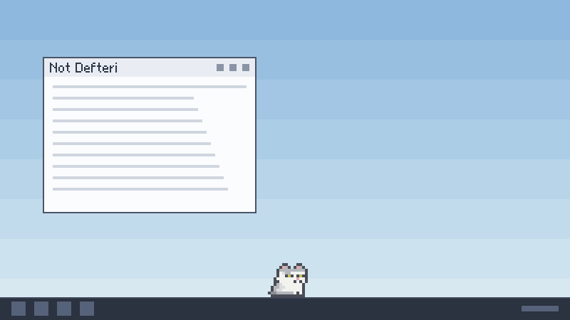

---

## 📦 Kurulum

1. [Releases](https://github.com/HakanYilmazzz/MasaustuMahallesi/releases/latest) sayfasından
   `MasaustuMahallesi-Kurulum-<sürüm>.exe` dosyasını indir.
2. Çalıştır. Kurulum programı dijital olarak imzalı olmadığı için Windows SmartScreen uyarı verebilir:
   **Ek bilgi**, ardından **Yine de çalıştır**.
3. Kurulum kullanıcı başınadır (`%LOCALAPPDATA%\Programs\MasaustuMahallesi`), yönetici izni istemez.
4. **Karakterler** sayfasında mahallede kimlerin yaşayacağını seç; istersen her birine kendi adını ver (2-14 karakter;
   harf, boşluk ve kesme işareti).
5. İstersen **Windows ile başlat**: oturum açıldıktan yaklaşık 15 saniye sonra mahalle sessizce gelir, komşular
   tek tek girip günaydın der.

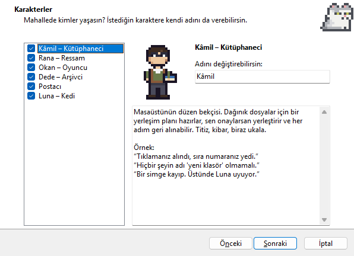

Yeni bir sürümün kurulum programını elle çalıştırırsan önceki karakter seçimin ve verdiğin adlar hazır gelir;
kayıtların ve ayarların korunur.

İlk açılışta kar küresi açılır ve komşular kendilerini tanıtır. Mahalleyi saatin yanındaki tepsi simgesinden (Luna'nın
yüzü) yönetirsin: simgeye tıklayınca menü açılır, çift tıklayınca Ayarlar. Simgeyi göremiyorsan önce görev çubuğundaki
**^** okuna tıkla; istersen Luna'yı oradan görev çubuğuna sürükleyebilirsin.

**Kaldırma:** Windows **Ayarlar → Uygulamalar** içinden Masaüstü Mahallesi'ni kaldır. Windows ile başlat kaydı silinir;
ayarların ve kayıtların yalnızca sorulduğunda "Evet" dersen silinir.

---

## 🔄 Güncellemeler

- Karakterler **tek tek**, **uygulama kapanmadan** ve **kendiliğinden** güncellenir (yeni sürüm yaklaşık 15 dakikada
  bir denetlenir): Postacı koliyi koşarak getirir, karakter koliye girer ve yeni haliyle çıkar; kaydı ve verdiğin ad korunur.
  İlk değişiklik notunu kısa bir balonla söyler, balona tıklarsan tam liste açılır.
- Uygulamanın kendisi güncellenecekse boş bir an beklenir (oyun, video, toplantı ya da tam ekran yokken). Herkes kısa bir
  "tadilat" için kaybolur, mahalle yeniden açılır ve komşular kaldıkları yerde belirip "Mahalle yenilendi!" der.
- **Ayarlar → Genel → Güncellemeler:** uygulamanın kendi güncellemesi için **Otomatik** ya da **Önce sor** (varsayılan:
  sağ alt köşede küçük bir pencere sorar, haberci yanına gelir; **Sonra** dersen tepside bekler). **Kapalı** seçilirse
  hiçbir şey denetlenmez, karakterler de güncellenmez.
- Tepsi menüsündeki **Güncellemeler** bölümünde durum satırı, **Şimdi denetle** ve **Neler yeni…** (son 20 güncelleme)
  bulunur.
- Uygulamanın kurulumu yarıda kalırsa (örneğin bir antivirüs dosyayı kilitlerse) mahalle eski haliyle yeniden açılır ve
  olay günlüğe yazılır; aynı sürüm iki kez kurulamazsa bir daha kendiliğinden denenmez, sana sorulur.
- Bir karakter güncellemesi sorun çıkarırsa o sürüm bir daha kurulmaz; karakter önceki sürümüyle devam eder.
- Yalnızca imzalı sürümler kurulur; her paketin boyutu ve özeti indirildikten sonra doğrulanır.

---

## 🔒 Gizlilik

- **Hiçbir veri dışarı gönderilmez.** Uygulama yalnızca güncelleme denetimi için GitHub'daki sürüm listesine bağlanır
  (açılıştan 90 sn sonra ve yaklaşık 15 dakikada bir; liste değişmemişse yeniden indirilmez; güncellemeler **Kapalı**
  ise hiç bağlanmaz). İnternetin gidip geldiğini Windows'a sorar, kendisi bağlantı kurmaz. Hava durumu bile hayalidir.
- **Klavye ve fare kancası yok.** Uygulama tuşlara ya da tıklamalara sistem genelinde kanca takmaz; girdiyi geciktirmez,
  araya girmez.
- **Klavye:** hangi tuşa basıldığı hiç okunmaz. "Yazıyor" algısı yalnızca Windows'un bildirdiği son girdi zamanından
  çıkarılır: son girdi zamanı ilerliyor ama imleç kıpırdamıyorsa yazıyorsun sayılır (sen yazarken susmak için). Bu algı
  varsayılan olarak kapalıdır; Ayarlar'daki **Klavye tepkileri** seçeneğiyle açılır.
- **Ses:** içerik değil, yalnızca sistem sesinin seviyesi okunur (ani seste irkilmek, müzikte kafa sallamak için). Bu
  algı da varsayılan olarak kapalıdır; Ayarlar'daki **Ses tepkileri** seçeneğiyle açılır.
- **İmleç:** yalnızca konumu, şekli ve fare tuşunun basılı olup olmadığı okunur; tıklamalar alttaki pencereye normal
  şekilde gider.
- **Pencere başlıkları:** yalnızca ilk açılıştaki soruya "Aç" dersen okunur ve yalnızca cihazda, bellekte işlenir.
  Banka, şifre, giriş ve gizli sekme gibi hassas pencerelerin başlıkları hiç işlenmez. Kayda yalnızca tür yazılır
  ("video", "oyun" gibi), başlığın kendisi asla.
- Bunların hiçbiri diske, günlüğe ya da ağa gitmez.
- **Günlük dosyası:** uyarı ve hatalar ile ekran ve güncelleme olayları `%APPDATA%\MasaustuMahallesi\logs` klasörüne
  yazılır (orası yazılamazsa `%TEMP%\MasaustuMahallesi\logs`). En fazla 1 MB'tır, dolunca en eski kısım silinir; ağa
  gönderilmez. İçinde yalnızca zaman, seviye ve teknik bilgi bulunur (örneğin "durum kaydı yazılamadı, dosya açılamadı"). Pencere başlıkları,
  karakterlere verdiğin adlar, hitap, kullanıcı adın ve kullanıcı klasörünün yolu yazılmadan önce silinir.
  **Tepsi → Yardım → Günlük klasörünü aç** klasörü açar; **Sorun bildirimi hazırla** aynı klasöre günlükleri ve sürüm
  bilgisini içeren tek bir zip yazar. Hiçbir şey gönderilmez; istersen zip'i sen paylaşırsın.
- **Kayıt uyarısı:** mahalle kayıtlarını diske yazamazsa (örneğin bir antivirüs engellerse) bir komşu seni uyarır,
  tepside "Kayıtlar yazılamıyor" satırı çıkar; tıklayınca veri klasörünün yeri ve antivirüste nasıl izin verileceği
  anlatılır.
- **Dosyalar:** dosya taşıma kendiliğinden yapılmaz; Kâmil'in planı yalnızca senin onayınla uygulanır, her adım geri
  alınabilir, hiçbir dosya silinmez.

---

## 💻 Sistem gereksinimleri

- Windows 10 ya da 11, 64 bit
- Yaklaşık 110 MB disk alanı
- Kaynak kullanımı düşük tutulur: karakterler hareket ederken saniyede 30 kare, herkes boştayken 10, herkes uyurken 5,
  mahalle gizliyken (tam ekran, herkes gizli) 2 kare çizilir.

---

## ❓ Sık sorulanlar

<b>Oyun oynarken engel olur mu?</b>

Hayır. Tam ekran bir uygulamanın açık olduğu monitörde hiçbir şey çizilmez ve kare hızı düşer. Toplantı ya da sunum
sırasında balonlar susar.

<b>Tıklamalarımı engeller mi?</b>

Hayır. Yalnızca karakterler, balonlar ve açtığın paneller tıklanabilir; geri kalan her tıklama alttaki pencereye geçer.
Uygulama odak da çalmaz.

<b>İki monitörde çalışır mı?</b>

Evet. Komşular monitörler arasında gidip gelir. **Ayarlar → Genel → Görüntü** bölümünden her monitörü açıp kapatabilir,
bütün monitörlerde aynı ölçeği seçebilirsin.

<b>Karakterleri nasıl kapatırım?</b>

**Ayarlar → Karakterler**'den istediğini kapatabilirsin (en az biri açık kalır). Kısa süreliğine herkesi göndermek için
tepsiden **Herkes dışarı** yeter (varsayılan kısayol Ctrl+Alt+Shift+M: 2 saniye içinde iki kez bas; bir kez basmak ekranı yeniler); süre dolunca ya da çağırınca geri gelirler.

<b>Simge nerede, nasıl çıkarım?</b>

Saatin yanındaki tepsi simgesi (Luna'nın yüzü). Görünmüyorsa görev çubuğundaki **^** okuna tıkla. Simgeye tıkla:
menüde **Çıkış** var. **Yardım → Nasıl çıkarım, ekran kararırsa?** aynı şeyi bir komşunun ağzından hatırlatır.

<b>Ekran karardı ya da dondu, ne yapayım?</b>

Herkes dışarı kısayoluna (varsayılan Ctrl+Alt+Shift+M) **bir kez** bas: mahalle ekranı yeniden çizer ve pencerelerini
yeniden kurar. Düzelmezse tepsiden **Çıkış** deyip uygulamayı yeniden aç; sorun sürerse **Yardım → Sorun bildirimi
hazırla** ile oluşan zip'i paylaşabilirsin.

<b>Verilerim nerede?</b>

`%APPDATA%\MasaustuMahallesi` klasöründe: ayarlar, karakterlerin kayıtları ve notların. Hepsi yalnızca senin
bilgisayarındadır.

---
---

## 🤔 Neden mahalleBaskısı?

Projenin ilk adı "mahalle baskısı"ydı, çünkü bu komşular tam olarak bunu yapar: sen yazarken (Klavye tepkileri açıksa)
birbirlerini susturur, uzun süre mola vermezsen hatırlatır, maçı kaybedince "Bir dahakine." der, alışverişten sonra bütçe tablosunu sorarlar.
Ama bu tatlı bir baskıdır: gördüklerini kimseye anlatmazlar, onaylamadığın hiçbir şeye dokunmazlar, sıkıldığında
**Herkes dışarı** dersen çaylarını alıp giderler.

---

## 📄 Lisans

Kaynak kod açık değildir; uygulama ücretsiz kullanım içindir.

---

## English summary

Masaüstü Mahallesi ("Desktop Neighborhood") is a small pixel-art neighborhood that lives on your Windows 10/11 desktop.
Six neighbors (a librarian, a painter, a gamer, a grandpa, a mail carrier and a cat) walk along your taskbar and window
title bars, greet each other, gather for afternoon tea and react to the windows, videos and games you open.
It never steals focus, and every click outside the characters goes straight to the window underneath.
Nothing leaves your computer: the app only contacts GitHub to check for signed updates. It installs no keyboard or
mouse hooks; it only reads the system's last-input time, sound level and cursor position, never their content. Characters are updated one by one without closing the app,
delivered by the mail carrier in a little parcel; the interface and dialogue are in Turkish.
